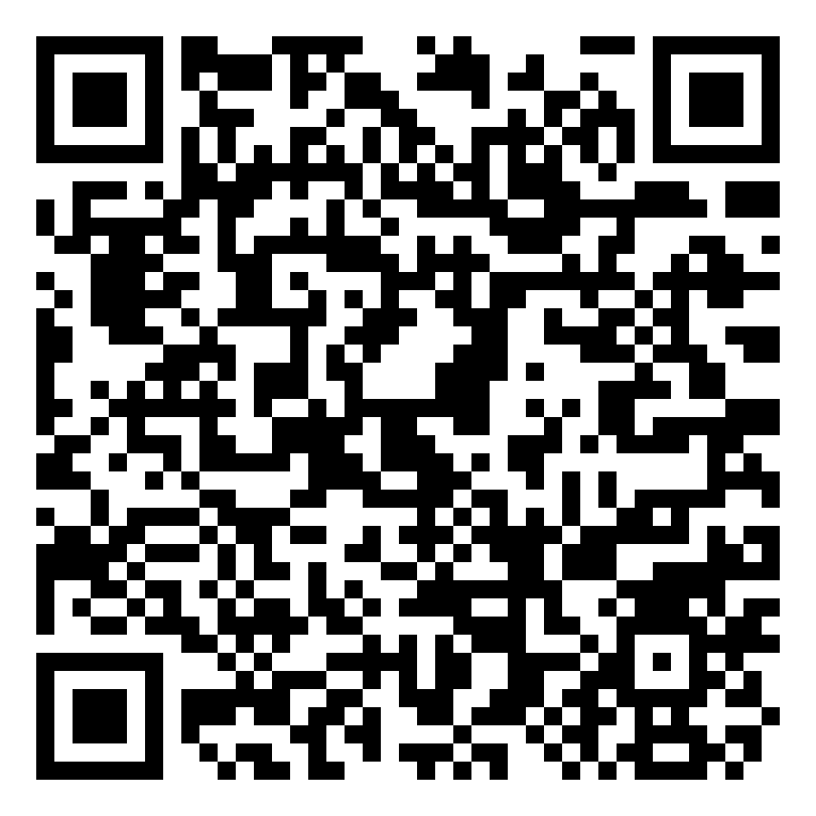

# Cardápio Digital — Morrison Bar & Rock'n'Roll

## QR Code do cardápio

  

  <b>Link:</b> <a href="https://card-pio-morrison.adrianobianhi-a28.workers.dev/">card-pio-morrison.adrianobianhi-a28.workers.dev</a> 
  Baixar: <a href="https://github.com/AdrianoBianchiCros/Card-pio-Morrison/raw/main/assets/qrcode.png">PNG</a> ·
  <a href="https://github.com/AdrianoBianchiCros/Card-pio-Morrison/raw/main/assets/qrcode.svg">SVG (para gráfica)</a> ·
  Cartões para imprimir: <a href="https://card-pio-morrison.adrianobianhi-a28.workers.dev/qrcode.html">qrcode.html</a>

> Publicado na Cloudflare, conectado à branch `main`: toda alteração enviada ao GitHub atualiza o site automaticamente.

Cardápio digital (HTML + CSS + JS puro, sem dependências) para ser acessado via QR Code.

**Endereço:** https://card-pio-morrison.adrianobianhi-a28.workers.dev/

## Estrutura

| Arquivo | Para quê |
|---|---|
| `index.html` | Página do cardápio |
| `css/style.css` | Visual (tema escuro, estilo jornal de rock) |
| `js/menu-data.js` | **Todos os itens e preços — edite aqui** |
| `js/app.js` | Renderização, busca, abas de categoria |
| `qrcode.html` | Folha imprimível com o QR Code (4 cartões por página) |
| `assets/qrcode.png` / `.svg` | QR Code apontando para o endereço acima |

## Atualizar preços

Abra `js/menu-data.js` e altere o valor de `price` (use ponto: `16.5` = R$ 16,50).
Para remover um item, apague a linha dele. Ao salvar e publicar, o QR Code continua o mesmo.

## Publicação

O site está hospedado na **Cloudflare**, conectado a este repositório (branch `main`).
Qualquer alteração enviada para a `main` é publicada automaticamente em cerca de 1 minuto. O QR Code não muda.

> Se usar outro domínio (ex.: `cardapio.morrisonbar.com.br`), gere um novo QR Code com:
> `pip install qrcode && python3 -c "import qrcode; qrcode.make('SUA_URL').save('assets/qrcode.png')"`

## Recursos

- Mobile first, abas fixas por categoria com destaque automático ao rolar
- Busca instantânea (ignora acentos) com destaque do termo
- Acessível: navegação por teclado, link "pular para o conteúdo", leitores de tela, contraste alto, respeita "reduzir movimento"
- Etiquetas: *Da casa*, *Em chamas*, *Promoção*, *Zero*
